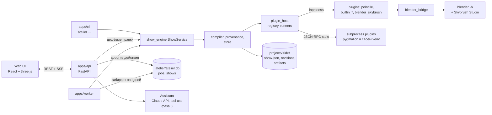

# Архитектура Atelier

Статус: фазы 1 (сквозной путь) и 2 (API, очередь, worker, веб-UI, Pygmalion) реализованы. Разделы с
пометкой «(фаза N)» для N ≥ 3 — согласованный дизайн, ещё не реализованный. Решения и обоснования — `docs/DECISIONS.md`; требования — `docs/SPEC.md`.

## Схема



`ShowService` — единая точка входа для всех действий; CLI, API и worker вызывают одни и те же методы.

## Пакеты и слои

| Пакет | Модуль | Назначение | Может импортировать |
|---|---|---|---|
| `packages/domain` | `atelier_domain` | Pydantic-схемы: Brief, FleetSpec (+ пресеты), ModelCard, Scene, AnimTrack, Pipeline, ArtifactRecord, Show | — |
| `packages/plugin_sdk` | `atelier_plugin_sdk` | роли, артефакты (MeshData, PointSet, CompiledShow), RunContext, dispatch + проверки контракта, JSON-RPC сервер, контрактные тесты, шаблоны | domain |
| `packages/plugin_host` | `atelier_plugin_host` | discovery, реестр, health-check, inprocess/subprocess раннеры, кэш компонентов, union-схемы | domain, plugin_sdk |
| `packages/show_engine` | `atelier_show_engine` | config, store (ревизии), provenance (stale), importing, geometry, compiler, `ShowService` | domain, plugin_sdk, plugin_host |
| `packages/blender_bridge` | `atelier_blender_bridge` | `run_blender`, прореживание ключей, скрипты `build_show.py`, `inspect_show.py`, `probe_skybrush.py` | domain |
| `packages/jobs` | `atelier_jobs` | SQLite (SQLModel): `jobs`, индекс `shows`, `JobQueue` | show_engine |
| `apps/worker` | `atelier_worker` | процесс, исполняющий задачи очереди | ядро, jobs |
| `apps/api` | `atelier_api` | FastAPI: REST, SSE, бинарные кадры, статика UI | ядро, jobs |
| `apps/cli` | `atelier_cli` | команда `atelier` (в т.ч. `atelier ui`) | всё ядро, jobs, worker, api |
| `apps/web` | — | веб-UI (React, TypeScript), сборка в `apps/web/dist` | только HTTP API |
| `plugins/*` | свои | реализации ролей | domain, plugin_sdk, blender_bridge |

Правила проверяет `tests/test_architecture.py` (AST).

## Соглашения
- **Координаты:** Z-up, метры, правая система. Зритель по умолчанию на `-Y`; фигура смотрит «лицом» на
  зрителя. glTF (Y-up, лицо на +Z) переводится при импорте: `(x, y, z) -> (x, -z, y)`.
- **Цвета:** внутри — линейные float [0,1]; в скомпилированном шоу и на экспорт — sRGB uint8. В Blender
  `Object.color` = sRGB/255 (так Skybrush читает цвет LED).
- **Время:** секунды; кадры — int при `Show.fps` (30). В Blender кадр = наш кадр + 1.
- **Детерминизм:** seed этапа = `derive_seed(show.seed, slot)`. Одинаковые входы → одинаковые массивы;
  `CompiledShow.content_hash` покрывает траектории, цвета, fps и таймлайн (не id шоу).

## Папка проекта

```
projects/<show_id>/
  show.json                       # текущая ревизия — единственный источник правды
  revisions/0001.json ... index.jsonl
  assets/<sha8>_<file>            # загрузки: модели, музыка (по содержимому)
  models/<model_id>/mesh_<fp8>.npz  points_<N>_<fp8>.npz
  compiled/trajectories_<fp8>.npz validation_<fp8>.json
  exports/<component>_<fp8>/      # builtin_csv_*/skybrush_csv.zip, blender_skybrush_blend_*/show.blend
  models/<model_id>/concepts_<fp8>/  # концепт-картинки; сгенерированный GLB импортируется в mesh_<fp8>.npz
  logs/jobs/<job_id>.log          # лог каждой задачи worker
  .work/                          # временные файлы шага; удаляются после успешного шага
  .lock                           # пока идёт запись
```
Файлы артефактов неизменяемы (`fp8` — начало fingerprint); любое изменение `show.json` — новая ревизия
через `ShowStore.commit` (атомарная запись, lock-файл, `ConflictError`). Откат — новая ревизия.

## Конвейер компиляции (фаза 1)
1. **Земля:** сетка `takeoff_grid_spacing_m`, почти квадратная, по центру `flight.grid_center_m`.
2. **Взлёт:** синхронный вертикальный подъём на `takeoff_altitude_m` (квинтика в пределах скорости
   подъёма и ускорения).
3. **Для каждой сцены:** точки модели → размещение (`geometry.place`: размер по `target_height_m` или
   минимальный безопасный с шагом `√2·d_min`, поворот к зрителю, `rotation_deg`, нижняя кромка на
   `formation_base_altitude_m`, `offset_m`) → кадры удержания с треками (`animation_primitive`, по треку на
   вызов) → переход от текущего состояния к первому кадру удержания (`transition_planner` назначает и
   ведёт) → переиндексация точек по назначению; цвета плавно смешиваются.
4. **Возврат и посадка:** переход к сетке на высоте взлёта, вертикальный спуск.
5. Таймлайн — `SceneMark` (`ground`, `takeoff`, `transition`, `hold`, `landing`), привязка нарушений к
   сценам по нему. Музыка по умолчанию стартует по окончании вертикального взлёта.

Ограничение фазы 1: каждая фигура использует весь флот (простаивающие дроны — позже, ADR-021).

## Плагинный контракт v1 (`api_version = "1"`)

### Термины
- **Плагин** — единица поставки: папка в `plugins/` (или пакет с entry point `atelier.plugins`) с
  `atelier-plugin.toml`.
- **Компонент** — реализация одной роли. Id = `<namespace>.<name>` (`builtin.min_distance`); если у
  плагина один компонент на роль — можно звать по id плагина (`pointille`, `blender_skybrush`).

### Манифест
```toml
id = "builtin_validators"
name = "Built-in validators"
version = "0.1.0"
api_version = "1"
namespace = "builtin"             # необязательно; по умолчанию = id
roles = ["validator_rule"]
runtime = "inprocess"             # inprocess | subprocess
entry = "atelier_builtin_validators:plugin"
command = []                      # subprocess; плейсхолдеры {python} {uv} {entry} {plugin_dir} {src}
                                  # и {setting:<key>} из [plugin_settings.<id>] в atelier.toml
requires_gpu = false
settings = {}                     # ключи настроек с описаниями, для экрана «Плагины»
```
Компоненты и их схемы хост получает при загрузке (import или RPC `initialize`); для subprocess-плагинов
кэширует в `.atelier/plugins.json` по (id, version), чтобы список не поднимал процессы.

### Роли
У каждого компонента: `name`, `version`, `Params: type[BaseModel]` (→ JSON Schema → форма в UI, описание
инструмента ассистента). Базовые классы — `atelier_plugin_sdk.roles`.

| Роль | Метод | Компоненты |
|---|---|---|
| `image_generator` | `generate(ctx, prompt, negative, n, params) -> ImageSetRef` | pygmalion (фаза 2) |
| `mesh_generator` | `generate(ctx, source: ImageRef \| str, params) -> MeshRef` | pygmalion (фаза 2) |
| `mesh_processor` | `process(ctx, mesh, params) -> MeshRef` | фаза 4 |
| `formation_source` | `build(ctx, source, params) -> MeshRef \| ContourRef` | фаза 4 |
| `point_distributor` | `distribute(ctx, source: MeshRef \| ContourRef, n, params) -> PointSetRef` | `pointille.blue_noise` |
| `animation_primitive` | `evaluate(points[T,N,3], mask[N], t[T], progress[T], params) -> [T,N,3]` | `builtin.rotate`, `builtin.scale_pulse` |
| `color_effect` | `evaluate(rest[N,3], base[N,3], t[T], progress[T], params) -> [T,N,3]` | фаза 5 |
| `transition_planner` | `plan(ctx, start[D,3], targets[D,3], fleet, fps, duration_s, params) -> TransitionPlan` | `builtin.hungarian_direct` |
| `validator_rule` | `check(ctx, show: CompiledShowRef, fleet, params) -> RuleResult` | `builtin.min_distance`, `.speed`, `.accel`, `.altitude` |
| `exporter` | `export(ctx, show: CompiledShowRef, out_dir, params) -> ExportResult` | `builtin.csv`, `blender_skybrush.blend` |
| `assistant_tool` | генерируется из ролей | фаза 3 |

- Ядерные роли (`animation_primitive`, `color_effect`) вызываются **один раз на трек по всем кадрам**.
  `points` — фигура в локальных координатах (центр, масштаб) после предыдущих треков, так треки
  компонуются; точки вне `mask` двигать нельзя. `t` — секунды от начала трека (обрезаны длительностью),
  `progress` — после easing.
- `TransitionPlan = (assignment[D], positions[F,D,3], duration_s)`: позиции включают оба конца,
  `duration_s == (F-1)/fps`; `duration_s=None` во входе — минимальная безопасная длительность.
- `RuleResult = (violations, metrics, truncated)`; `Violation` — окно кадров, дроны, худшее значение,
  лимит; сцену и сегмент дописывает ядро.
- Распределитель, не умеющий контуры, отвечает `PluginError` на `ContourRef` (тип в контракте полный).
- Общие геометрические вещи ядро держит у себя: `PointSet.evaluate(faces, vertices)` (точки на
  деформированном меше) — в SDK; `min_safe_scale` — в `show_engine.geometry`.

### Артефакты и RunContext
- Ссылки (путь + `meta`) и numpy-контейнеры: `MeshData` (vertices, faces, vertex_colors, uv, texture,
  base_color), `PointSet` (positions, normals, colors, tri_index, barycentric, meta), `CompiledShow`
  (positions float32, colors uint8, fps, marks, audio, meta с `fleet`).
- `RunContext`: `seed`, `rng()`, `workdir`, `output_path()`, `save()`, `progress()`, `log()`,
  `cancelled()`, `config` — настройки хоста (`blender_exe`, `skybrush_addon`, `blender_timeout_s`).
- Плагин не пишет provenance; хост проверяет вывод (`contracts.check_output`) и для subprocess — повторно.

### Subprocess: JSON-RPC 2.0 по stdio
- NDJSON (одна UTF-8 строка на сообщение, ≤ 16 MB), большие данные — файлами (`$ndarray` → `.npy`,
  `$ref` → путь артефакта, `$type` → модели).
- `python -m atelier_plugin_sdk.serve --entry pkg:plugin --path src`: дубликаты настоящих stdin и
  stdout — под протокол; коду плагина fd 0 → NUL, fd 1 → stderr (посторонние принты не ломают канал),
  stderr → лог плагина. NUL на stdin обязателен под Windows: синхронный pipe пропускает одну операцию,
  и нативная библиотека (BLAS у scipy), спрашивающая stdin при загрузке в потоке вызова, ждала бы
  чтения протокола — взаимная блокировка.
- Хост → плагин: `atelier.initialize`, `atelier.health`, `atelier.normalize_params`, `atelier.invoke`,
  `atelier.cancel`, `atelier.shutdown`. Плагин → хост: `atelier.progress`, `atelier.log`.
- Ошибки: `-32602` InvalidParams, `1001` PluginError, `1002` ResourceExhausted (`data.hint`),
  `1003` Cancelled, `1004` ContractViolation.
- Жизненный цикл: ленивый старт (первый `initialize` — до 15 мин: может строиться venv), тёплый процесс,
  таймаут вызова с убийством дерева процессов (`taskkill /T`), рестарт по требованию,
  `CREATE_NO_WINDOW`.

### Provenance и stale
Запись `ArtifactRecord`: слот, producer (компонент, версии плагина/компонента, api), нормализованные
параметры, seed, входы, fingerprint, content_hash. `Provenance` строит ожидание для каждого слота из
текущего `show.json` и реестра; stale = ожидаемый fingerprint ≠ записанного, причина вычисляется
(«component changed», «parameters changed: …», «input … is stale»). Импорт меша и сам компилятор —
продюсеры ядра с собственной версией алгоритма (`core_producer`). Версия компонента Pointille включает
коммит Pointille — обновление библиотеки делает точки устаревшими.

### Контрактные тесты и шаблоны
`atelier_plugin_sdk.testing.run_contract_suite(invoker, workdir)` — наборы для `point_distributor`,
`animation_primitive`, `transition_planner`, `validator_rule`, `exporter`. `atelier plugin test <id>`
гоняет их inprocess и через subprocess-сервер SDK. `atelier plugin new <id> --role ...` создаёт
рабочий каркас (четыре роли), проходящий контракт и `mypy --strict`.

## Blender
- `run_blender(exe, script, args)` — `blender -b --offline-mode --python-exit-code 1 --python <script> --
  --args args.json`, таймаут, лог, результат JSON.
- `build_show.py`: дроны из шаблона Skybrush, ключи `location`/`color` через `foreach_set` (прореженные
  RDP с допуском 2 см и 2/255), сторибординг MANUAL TAKEOFF / SHOW (по сцене) / LANDING с формациями,
  пороги safety из флота, звук, сохранение и сверка выборки кадров.
- `inspect_show.py`: открывает готовый `.blend` в отдельном процессе и отдаёт то, что видит Skybrush.

## Сервер, очередь и UI (фаза 2)
- **`atelier ui`** поднимает API на `127.0.0.1:8710` (без авторизации, только локально), отдаёт
  `apps/web/dist` и запускает рядом процесс worker (лог `.atelier/logs/worker.log`, при выходе
  убивается с деревом). `atelier worker` — worker отдельно.
- **Человек в контуре.** Дешёвые правки (бриф, флот, модели, сцены, pipeline, утверждение этапа,
  откат) API делает сразу через `ShowService` — новая ревизия с автором `ui`. Точки, компиляция,
  проверка, экспорт и генерация — только задачи очереди по явной кнопке; экспорт — с подтверждением.
- **API** (`/api`): шоу и правки (`base_revision`, 409 при конфликте), загрузки GLB/музыки, модели,
  сцены, pipeline, задачи (`POST …/jobs`, отмена, лог), результаты (`compiled`, `compiled/frames`,
  `validation`, `exports`, файлы проекта для скачивания), ревизии и diff, плагины (вкл/выкл, health,
  компоненты и схемы ролей), `events` (SSE). Ошибки сервиса — 400/404 с понятным текстом.
- **Очередь** (ADR-022…024): SQLite, атомарный забор задачи, прогресс и отмена через БД, события SSE
  опросом БД раз в 300 мс.
- **UI** (ADR-029): список шоу; экран шоу — «Материалы» (бриф, флот, модели, музыка), рабочая
  область (3D: модель / точки с тепловой картой дистанций / проигрывание шоу; таймлайн с бюджетом,
  музыкой и маркерами нарушений; pipeline с формами из схем; ревизии с diff и откатом; чат — фаза 3),
  «Студия» (этапы, статусы, stale с причиной, действия) и панель задач; экран «Плагины».
- **Координаты во вьюере:** группа сцены повёрнута на −90° по X, show (x, y, z) → three (x, z, −y);
  зритель (−Y) стоит перед камерой.

## CLI
`atelier new | list | use`, `fleet presets | use | set`, `music set`, `add-model [--glb]` (без `--glb`
— пустая карточка под генерацию), `points`, `scene add | list`, `pipeline show | set | validators |
exporters`, `status`, `compile`, `validate`, `export`, `history`, `rollback`, `doctor`,
`plugin list | new | test`, `generate images | mesh`, `ui`, `worker`. Текущее шоу: `--show`,
`ATELIER_SHOW`, папка с `show.json` или последнее использованное (`.atelier/current_show`).
