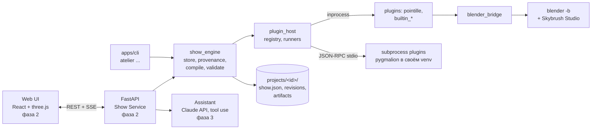

# Архитектура Atelier

Статус: фаза 0 (каркас). Разделы, помеченные «(фаза N)», описывают согласованный дизайн, который
ещё не реализован. Решения и их обоснования — `docs/DECISIONS.md`; требования — `docs/SPEC.md`.

## Схема



Модульный монолит: один backend-процесс + один worker (фаза 2); сейчас всё доступно через CLI.

## Пакеты и слои

| Пакет | Модуль | Назначение | Может импортировать |
|---|---|---|---|
| `packages/domain` | `atelier_domain` | Pydantic-схемы: Brief, FleetSpec, ModelCard, Scene, AnimationSpec, Pipeline, ArtifactRecord, Show | — |
| `packages/plugin_sdk` | `atelier_plugin_sdk` | роли, типы артефактов, RunContext, RPC-сервер, шаблон плагина, контрактные тесты | domain |
| `packages/plugin_host` | `atelier_plugin_host` | discovery, реестр, health-check, inprocess/subprocess раннеры, union-схемы | domain, plugin_sdk |
| `packages/show_engine` | `atelier_show_engine` | `store` (show.json, ревизии), provenance, оркестрация этапов, компилятор, валидация | domain, plugin_sdk, plugin_host |
| `packages/blender_bridge` | `atelier_blender_bridge` | `run_blender`, прореживание ключей, скрипты внутри Blender | domain |
| `apps/cli` | `atelier_cli` | команда `atelier` | всё ядро |
| `plugins/*` | свои | реализации ролей | domain, plugin_sdk, blender_bridge |

Правила проверяет `tests/test_architecture.py` (AST): ядро не импортирует пакеты плагинов,
пакеты ядра импортируют только нижние слои, плагины — только публичное ядро.

## Соглашения
- **Координаты:** Z-up, метры, правая система. Зритель по умолчанию на `-Y` (`Brief.viewer_direction`),
  «перед» фигуры смотрит на зрителя. GLB (Y-up, лицо на +Z) переводится в Z-up при импорте.
- **Цвета:** внутри — линейные float [0,1]; в скомпилированном шоу и на экспорт — sRGB uint8.
- **Время:** секунды (float); кадры — int при `Show.fps` (по умолчанию 30).
- **Детерминизм:** seed этапа = hash(`Show.seed`, слот). Одинаковый `show.json` → одинаковые
  массивы; тесты сравнивают хэши содержимого, не байты npz.

## Папка проекта (фаза 1)

```
projects/<show_id>/
  show.json                 # текущая ревизия (единственный источник правды)
  revisions/0001.json ...   # полные снимки; index.jsonl — сообщение, автор, время
  assets/                   # загрузки пользователя: GLB/OBJ, музыка, референсы
  models/<model_id>/
    raw_<fp8>.glb  mesh_<fp8>.npz  points_<N>_<fp8>.npz
  compiled/
    trajectories_<fp8>.npz  # positions float32 [F,D,3], colors uint8 [F,D,3], scene timecodes
    validation_<fp8>.json
  exports/  logs/
```

Все записи `show.json` идут через `ShowStore.commit(show, base_revision, message, author)`:
атомарная запись (temp + `os.replace`), lock-файл, `ConflictError` при чужой правке. Откат
создаёт новую ревизию. Файлы артефактов неизменяемы.

## Плагинный контракт v1 (`api_version = "1"`)

### Термины
- **Плагин** — единица поставки: папка в `plugins/` (или установленный пакет, entry point
  `atelier.plugins`) с `atelier-plugin.toml`.
- **Компонент** — реализация одной роли внутри плагина. Id = `<namespace>.<name>`
  (`builtin.min_distance`); если у плагина один компонент на роль — можно звать по id плагина
  (`pointille`).

### Манифест
```toml
id = "builtin_validators"
name = "Built-in validators"
version = "0.1.0"
api_version = "1"                 # версия контракта ядра
namespace = "builtin"             # необязательно; по умолчанию = id
roles = ["validator_rule"]
runtime = "inprocess"             # inprocess | subprocess
entry = "atelier_builtin_validators:plugin"   # для inprocess
command = []                      # для subprocess: запуск в своём venv
requires_gpu = false
```
Список компонентов и их схем хост получает при загрузке (import или RPC `initialize`) и кэширует
в `.atelier/cache/plugins.json` по (id, version).

### Роли
У каждого компонента: `name`, `version`, `Params: type[BaseModel]` (→ JSON Schema → автоформа в
UI и описание инструмента для ассистента).

| Роль | Метод | Первые компоненты |
|---|---|---|
| `image_generator` | `generate(ctx, prompt, negative, n, params) -> ImageSetRef` | pygmalion |
| `mesh_generator` | `generate(ctx, source: ImageRef \| str, params) -> MeshRef` | pygmalion |
| `mesh_processor` | `process(ctx, mesh, params) -> MeshRef` | builtin.clean_mesh |
| `formation_source` | `build(ctx, source: TextSpec \| AssetRef, params) -> MeshRef \| ContourRef` | builtin.text, builtin.svg |
| `point_distributor` | `distribute(ctx, source, n, params) -> PointSetRef` | pointille |
| `animation_primitive` | `evaluate(rest[N,3], mask[N], t[T], progress[T], params) -> [T,N,3]` | builtin.rotate, builtin.scale_pulse |
| `color_effect` | `evaluate(rest[N,3], base[N,3], t[T], progress[T], params) -> [T,N,3]` | builtin.gradient (фаза 5) |
| `transition_planner` | `plan(ctx, start[D,3], targets[D,3], fleet, fps, duration_s, params) -> TransitionPlan` | builtin.hungarian_direct |
| `validator_rule` | `check(ctx, show: CompiledShowRef, fleet, params) -> list[Violation]` | builtin.min_distance, builtin.speed, builtin.accel, builtin.altitude |
| `exporter` | `export(ctx, show, out_dir, params) -> ExportResult` | blender_skybrush, builtin.csv |
| `assistant_tool` | генерируется из ролей | фаза 3 |

- `animation_primitive`/`color_effect` вызываются **один раз на трек по всем кадрам**
  (`t` — секунды от начала трека, `progress` — нормированное время после easing). Маску региона
  (`all`/`plane_split`/`box`) ядро вычисляет по позициям покоя.
- `TransitionPlan = (assignment[D], positions[F,D,3], duration_s)`; ядро переиндексирует дронов
  по `assignment`.

### Артефакты и RunContext
- Ссылки (Pydantic, путь + метаданные) и numpy-контейнеры с `save`/`load` в npz: `MeshData`
  (vertices, faces, vertex_colors, uv?), `PointSet` (positions, normals, colors, tri_index,
  barycentric), `CompiledShow`.
- `RunContext`: `seed`, `rng()`, `workdir`, `output_path(name)`, `save(obj, name)`,
  `progress(fraction, msg)`, `log`, `cancelled()`, `fleet`. Для subprocess SDK собирает тот же
  объект из RPC — код плагина не меняется.
- Плагин не пишет provenance: он возвращает ссылку, запись регистрирует хост.

### Subprocess: JSON-RPC 2.0 по stdio
- NDJSON: одна UTF-8 строка JSON на сообщение, ≤ 16 MB; большие данные — только файлами.
- Сервер SDK (`python -m atelier_plugin_sdk.serve --entry pkg:plugin`) при старте берёт
  дубликат настоящего stdout под протокол и перенаправляет fd 1 в stderr — посторонние принты
  (torch, Pygmalion) не портят канал; stderr уходит в лог задачи.
- Хост → плагин: `atelier.initialize {api_version, host_version}` →
  `{plugin, components: [{id, role, version, description, params_schema}]}`;
  `atelier.health` → `{status: ok|degraded|error, message}`;
  `atelier.invoke {call_id, component, method, args, params, ctx: {seed, workdir}}` → `{result}`;
  `atelier.cancel {call_id}`; `atelier.shutdown`.
- Плагин → хост (уведомления): `atelier.progress {call_id, fraction, message}`,
  `atelier.log {level, message}`.
- Данные: `{"$ref": "point_set", "path": "...", "meta": {...}}`, массивы —
  `{"$ndarray": "<path>.npy"}`.
- Ошибки: `-32602` (невалидные параметры, `data` — ошибки Pydantic), `1001 PluginError`,
  `1002 ResourceExhausted` (VRAM; `data.hint`), `1003 Cancelled`, `1004 ContractViolation`.
- Жизненный цикл: ленивый старт, тёплый процесс, idle-таймаут для GPU-плагинов, таймаут на
  вызов, kill дерева процессов; Windows — `CREATE_NO_WINDOW`, аргументы списком.

### Provenance и stale
```python
class ArtifactRecord(BaseModel):
    id: str
    kind: ArtifactKind
    path: str                  # relative to the project dir; the file is never overwritten
    producer: Producer         # component id, plugin id + version, role, api_version
    slot: str                  # e.g. "models.m_horse.points.150", "compiled"
    params: dict[str, Any]     # normalized, defaults filled
    seed: int | None
    inputs: list[str]          # artifact ids
    fingerprint: str           # sha256 of canonical JSON (producer, params, seed, input fingerprints)
    content_hash: str          # sha256 of array contents
    created_at: datetime
    status: Literal["ready", "failed"]
```
`stale` вычисляется: ожидаемый fingerprint слота (текущий `pipeline` + переопределения модели
или сцены + актуальные входы) ≠ записанного. Смена параметров Pointille → stale точки →
compiled → validation. Компилятор не берёт stale-входы без `--allow-stale`.

### Минимальный плагин (то, что генерирует `atelier plugin new`, фаза 1)
```python
# plugins/demo_distributor/src/demo_distributor/__init__.py
from __future__ import annotations

import numpy as np
from pydantic import BaseModel, Field

from atelier_plugin_sdk import Health, MeshRef, Plugin, PointDistributor, PointSet, PointSetRef, RunContext


class RandomParams(BaseModel):
    area_weighted: bool = Field(True, description="Pick triangles proportionally to their area")


class RandomDistributor(PointDistributor[RandomParams]):
    """Uniform random surface sampling: a baseline to compare against Pointille."""

    name = "random"
    version = "0.1.0"
    Params = RandomParams

    def distribute(self, ctx: RunContext, source: MeshRef, n: int, params: RandomParams) -> PointSetRef:
        mesh = source.load()                               # MeshData: vertices[V,3], faces[F,3]
        tris = mesh.vertices[mesh.faces]                   # [F,3,3]
        area = 0.5 * np.linalg.norm(np.cross(tris[:, 1] - tris[:, 0], tris[:, 2] - tris[:, 0]), axis=1)
        weights = area if params.area_weighted else np.ones_like(area)
        rng = ctx.rng()
        tri_index = rng.choice(len(tris), size=n, p=weights / weights.sum())
        r1, r2 = np.sqrt(rng.random(n)), rng.random(n)
        bary = np.stack([1 - r1, r1 * (1 - r2), r1 * r2], axis=1)
        positions = np.einsum("nk,nkd->nd", bary, tris[tri_index])
        ctx.progress(1.0, f"sampled {n} points")
        points = PointSet(
            positions=positions,
            normals=mesh.face_normals()[tri_index],
            colors=mesh.sample_colors(tri_index, bary),
            tri_index=tri_index.astype(np.int32),
            barycentric=bary,
        )
        return ctx.save(points, "points.npz")


plugin = Plugin(components=[RandomDistributor()], health_check=Health.ok)
```

### Контрактные тесты
`atelier_plugin_sdk.testing` — наборы проверок на роль на эталонных данных SDK (для
`point_distributor`: ровно n, точки на поверхности, `tri_index` в диапазоне, детерминизм по
seed, `Params` → JSON Schema). `atelier plugin test <id>` гоняет набор inprocess и через
subprocess-обёртку SDK.

## Blender
- `run_blender(script, args_json)` — `blender -b --offline-mode --python-exit-code 1 --python
  <script> -- <args>`, таймаут, лог в `projects/<id>/logs/`, путь к `blender.exe` из
  `atelier.toml` (фаза 1).
- Скрипты внутри Blender используют только stdlib, numpy, bpy и sbstudio; вход — JSON/NPZ.
- Проверенный путь сборки (проба фазы 0, `docs/SKYBRUSH_NOTES.md`): `bpy.ops.skybrush.prepare()`
  → `create_drone` из шаблона → ключи `location`/`color` через `foreach_set` → сторибординг
  MANUAL → звуковой стрип → `save_as_mainfile`.
